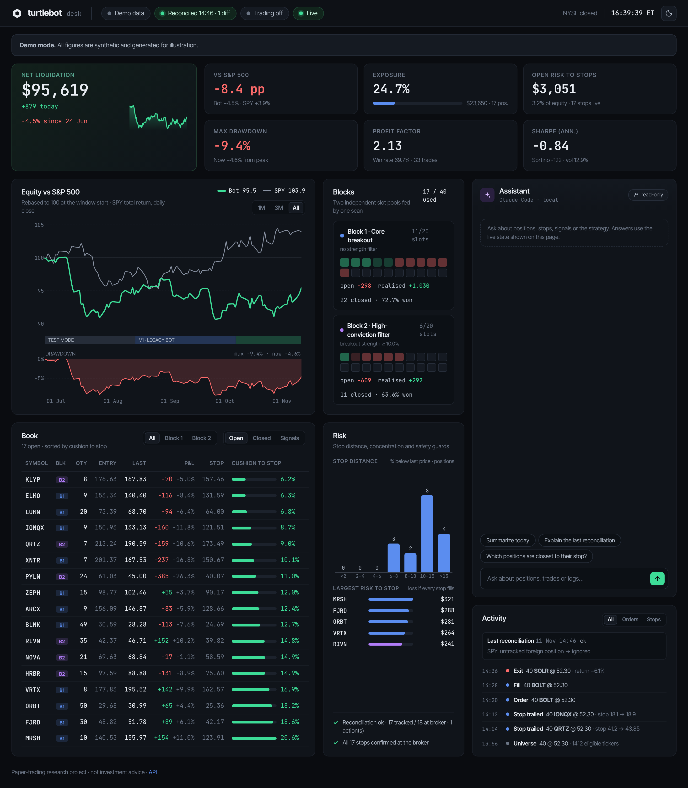
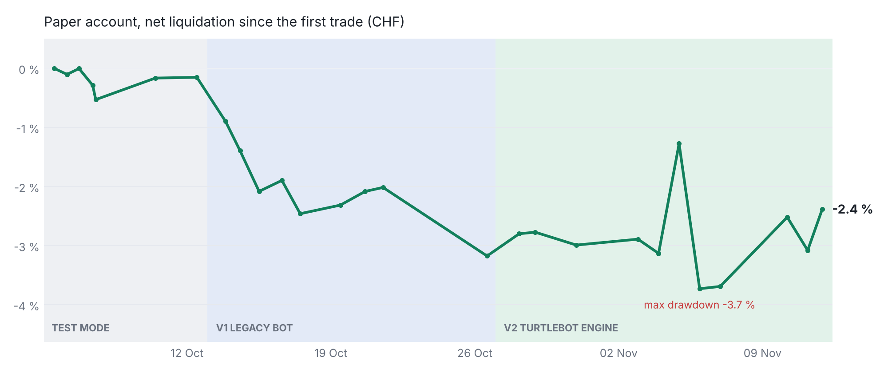
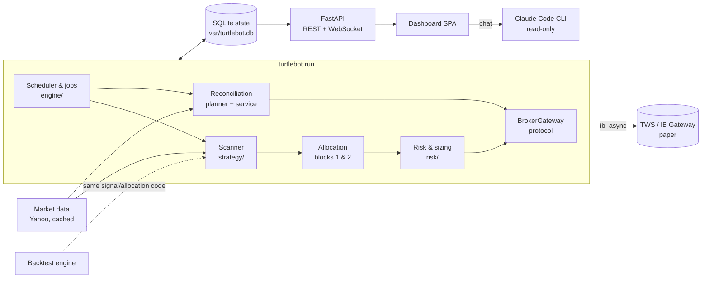

# turtlebot

**A Turtle/Donchian breakout trading bot for Interactive Brokers paper accounts, with a SQLite-backed state store, a safety-first reconciliation and a real-time dashboard.**

[](.github/workflows/ci.yml)


turtlebot scans about 2,200 liquid US stocks every afternoon for 20-day breakouts on heavy volume, buys the strongest ones at the close with a stop at the 10-day low, and trails that stop every morning. It has been trading an IBKR paper account since October 2026. The interesting parts are less the entry rule than everything around it: a research process that tried to break its own results, a reconciliation that survived a real broker incident, and a dashboard that shows the bot against the market without hiding the bad weeks.

> [!WARNING]
> **Paper-trading and learning project, not investment advice.** The bot only connects to IBKR *paper* accounts (port 7497, account ids starting with `D`) and refuses everything else. Backtest and paper results say nothing about future returns. Use at your own risk.

<picture>
  <source media="(prefers-color-scheme: light)" srcset="docs/screenshots/dashboard-light.png">
  
</picture>

*Dashboard in demo mode with synthetic data. [Open the live demo](https://wenjadebug.github.io/turtlebot/) in the browser, or run it locally with `turtlebot dashboard --demo`.*

## Results so far

**IBKR paper account.** The first two trading days ran a deliberately loose *test mode* (10-day breakout, 1.3× volume, hourly scans) whose only job was to prove order routing on the live paper account. Those trades follow different rules, so they are reported separately and not counted as strategy results:

| | Bot | S&P 500 |
|---|---|---|
| **All trades under the production rules** (entries 13 Oct – 09 Nov, test-mode trades excluded) | **+0.6 %** (+6,700 USD, realised and unrealised) | −3.3 % |
| **Since the v2 engine took over** (27 Oct – 10 Nov, in USD) | **+0.6 %** | −1.9 % |
| Exposure and beta | 37 % invested on average, beta 0.4 | |

<picture>
  <source media="(prefers-color-scheme: dark)" srcset="docs/img/paper-account-dark.png">
  
</picture>

The chart is the full account since the very first order, including the two test-mode days at the start. Five weeks prove nothing either way: most of the gains are still open positions, which is how a trend-following system looks early on. [docs/results.md](docs/results.md) has the breakdown by phase, the market comparison and the caveats.

## Try it

No broker account needed for the demo:

```bash
git clone https://github.com/WenjaDebug/turtlebot.git && cd turtlebot
python3 -m venv .venv && source .venv/bin/activate
pip install -e .
turtlebot dashboard --demo        # http://127.0.0.1:8000
```

To trade on your own IBKR paper account, follow [docs/setup-ibkr.md](docs/setup-ibkr.md) (TWS settings, configuration, dry runs, going live).

## Documentation

| | |
|---|---|
| [Strategy](docs/strategy.md) | The rules, the two blocks and the evidence behind each choice, including ten years of signals |
| [Research journey](docs/research-journey.md) | From moving-average experiments to the current system: what was tested, what failed, what changed |
| [Results](docs/results.md) | Paper-trading results by phase, against the market, with known data gaps |
| [IBKR setup](docs/setup-ibkr.md) | Step-by-step guide from a fresh clone to a bot on a paper account |
| [Changelog](CHANGELOG.md) | Release notes |

The project was built with [Claude Code](https://claude.com/claude-code) as a pair programmer; the research questions, trading rules and design decisions are mine, and every change was reviewed before it went live.

---

## What it does

| | |
|---|---|
| **Strategy** | Long-only Donchian breakout: close above the 20-day high with volume > 1.5x its 20-day average. Initial stop at the 10-day low, trailed upwards every morning. |
| **Two blocks** | Two independent slot pools (20 each) fed by the same scan. Block 1 takes the strongest signals; block 2 only takes signals with breakout strength >= 10 % that block 1 does not hold. |
| **Execution** | Scan at 15:45 ET, entries as market-on-close (market-on-open after the MOC cutoff), each as a bracket with an attached GTC stop. |
| **Risk** | 1.5 % of net liquidation per position, margin cushion check (TWS what-if), daily loss kill switch (-2 %), max 10 new entries per block and day. |
| **State** | SQLite store as the bot's source of truth; every reconciliation with the broker is recorded with its discrepancies. |
| **Dashboard** | FastAPI REST + WebSocket backend, hand-built frontend: equity against the S&P 500 with project phases and drawdown, slot grids per block, live positions with cushion to stop, risk panel with safety guards, activity feed and a read-only assistant (local Claude Code). |

All parameters are configurable (see [`.env.example`](.env.example)); the defaults reproduce the production setup exactly.

## Architecture



```
src/turtlebot/
├── config.py            Pydantic settings (.env, TURTLE_* variables)
├── exceptions.py        Exception hierarchy (transient vs. fatal broker errors, ...)
├── logging_setup.py     JSON-lines logs + order audit log
├── domain/models.py     Broker-independent value objects
├── strategy/            signals (Donchian), scanner, block allocation
├── risk/                position sizing, kill switches, margin checks
├── broker/              BrokerGateway protocol, IBKR adapter, dry-run wrapper, backoff
├── data/                market data protocol + Yahoo implementation
├── persistence/         SQLite schema/migrations and StateStore
├── reconciliation/      pure planner + executor (see below)
├── engine/              TradingEngine, job runner, watchdog
├── backtest/            portfolio backtest reusing the live strategy code
├── analytics/           Sharpe, Sortino, drawdown, win rate, profit factor ...
├── dashboard/           FastAPI app, read model, chat, static frontend
├── migration.py         import of the legacy JSON state / CSV journal
└── cli.py               `turtlebot` command
```

Design principles:

* **Pure core, thin adapters.** Signals, allocation, risk checks, the reconciliation planner and the metrics are pure functions over domain objects. Everything that touches TWS, the network or the clock is injected. That makes the trading logic testable without a broker.
* **One code path.** The backtest uses the same signal, allocation and sizing functions as the live engine.
* **Fail safe, not silent.** Unclear broker data means *do nothing destructive and alert*, never *assume everything is closed*.

## State management & the 12.10.2026 incident

On 12.10.2026 the legacy bot reconnected to TWS and received an empty position list before TWS had finished syncing. Its reconciliation took that at face value: it "forgot" all 20 open positions **and cancelled their stop-loss orders**, leaving the positions unprotected.

A second, related problem followed: the stops re-placed by the repair script belonged to API client id 50, so from 13.10. on every attempt of the bot (client id 11) to trail them was rejected by TWS (error 103) while the legacy state recorded the intended prices.

The new design prevents both structurally:

1. **Local source of truth.** Positions, orders, stops and every event live in SQLite (`var/turtlebot.db`, WAL mode). Nothing is rewritten wholesale; each change is a transaction.
2. **Reconciliation is a plan, not a side effect.** `reconciliation/planner.py` compares the store with a broker snapshot and returns explicit *discrepancies* plus *actions*. Every run is persisted (`reconciliations`, `discrepancies` tables) and visible in the dashboard.
3. **Safety rules:**
   * snapshots without a confirmed end of the position stream are ignored (`ABORTED`);
   * 0 broker positions while positions are tracked, without matching executions -> `ABORTED`;
   * a large share of positions vanishing at once -> `DEGRADED`: nothing is closed or cancelled;
   * a single missing position is closed only after a SELL execution proves it, or after it is missing for N consecutive runs;
   * a stop is cancelled only once its position is confirmed closed; the executor additionally refuses to cancel a SELL order for any symbol the broker still reports as held.
4. **Stop ownership.** TWS only lets the API client id that placed an order change it. Stops placed by another client id (e.g. a repair script, or manually in TWS) are read via `reqAllOpenOrders()`, count as protection, are reported with symbol, order id and client id, and are never modified or cancelled. If TWS rejects a modification (e.g. error 103), the bot cancels the old stop and only places a replacement after TWS confirms the cancellation; otherwise it leaves the old stop in place and alerts. `turtlebot audit-orders` (read-only session) lists all working orders not owned by the bot.
5. **Unverified stops.** Stops imported from the legacy state are marked unconfirmed; the first reconciliation reports any difference to the working TWS stop as `stop_price_mismatch` with both values.
6. **Checked price data.** Before a stop is trailed, the Yahoo 10-day low is compared with TWS's own (adjusted) daily bars; if they differ by more than 2 % the TWS low is used, and without TWS bars the stop is not trailed in that run. Warnings (log, notification, dashboard) flag lows far below the surrounding closes and the pattern of a pending cash takeover (jump on heavy volume, then a pinned price), where the trailing stop stays far below the price for up to 10 sessions. The dashboard also warns when a stop is more than 25 % below the price. None of this changes the strategy.
7. **Regression tests** replay the incident end to end (`tests/reconciliation/test_incident_20261012.py`): empty list, partially synced list, glitch persisting for 10 cycles, lost local state. In each case no stop is cancelled and no position is forgotten.

## Setup

Requirements: Python 3.12+, TWS or IB Gateway with API access on the paper port 7497, optionally [Claude Code](https://claude.com/claude-code) for the dashboard assistant. The full walkthrough is in [docs/setup-ibkr.md](docs/setup-ibkr.md).

```bash
git clone https://github.com/WenjaDebug/turtlebot.git && cd turtlebot
python3 -m venv .venv && source .venv/bin/activate
pip install -e ".[dev]"
cp .env.example .env          # adjust if needed; .env is git-ignored
pre-commit install
```

### Migrating from the legacy bot

```bash
turtlebot migrate-legacy --state live_turtle_state.json --journal live_turtle_journal.csv
turtlebot report               # check positions and the imported history
```

Run the migration right before switching over, while the legacy bot is stopped. The legacy state file is treated as authoritative for open positions; false EXIT rows from the 12.10. incident are recognised and ignored.

### Running

```bash
turtlebot run --dry-run --once   # connect read-only, reconcile, one scan, no orders
turtlebot run --dry-run --reconcile-only  # read-only reconciliation, no scan
turtlebot run --dry-run          # full schedule without orders (separate database)
turtlebot run                    # paper trading - requires TURTLE_TRADING_ENABLED=true
turtlebot dashboard              # http://127.0.0.1:8000
turtlebot dashboard --demo       # synthetic data, no account needed
turtlebot export-demo _site      # static demo for GitHub Pages (synthetic data)
turtlebot backtest --universe .cache/live/eligible_20261009.json --start 2016-01-01 --end 2026-10-01
```

`turtlebot run` refuses to place orders unless `TURTLE_TRADING_ENABLED=true` is set explicitly. The paused state is the default.

The dashboard compares the account curve with a benchmark (SPY daily closes from Yahoo by default; `TURTLE_DASHBOARD__BENCHMARK_SYMBOL=""` turns it off) and can mark project phases on the equity chart:

```bash
TURTLE_DASHBOARD__PHASES='[{"label": "Test mode", "start": "2026-10-05"}, {"label": "v2 engine", "start": "2026-10-27"}]'
```

### Operating mode

The bot runs on a laptop during US market hours and is shut down overnight. Positions stay protected by their GTC stop orders at the broker while it is offline; on the next start it reconnects, reconciles against TWS and catches up on a missed stop update before the open. TWS disconnects at night are therefore expected and not treated as failures.

### Exit accounting

TWS reports executions through the API only for a short time. If a position disappears while the bot is offline, the reconciliation waits for several runs before treating it as closed, and the exit price stays unknown. Two commands close that gap:

```bash
turtlebot import-executions trades.csv           # preview: match an IBKR trade export to closed positions
turtlebot import-executions trades.csv --apply   # store exact exit prices (VWAP of all partial fills)
turtlebot confirm-closed HTZ --price 6.12 --yes  # close a position you verified as sold in TWS
```

The import only updates a position if the SELL executions between its entry and close add up to its full quantity; everything else is reported and left untouched. Partial executions of one stop order are always combined into a single exit at their volume-weighted price.

### Logs

* `var/log/turtlebot.jsonl`: everything, one JSON object per line (`jq 'select(.level=="WARNING")'`)
* `var/log/orders.jsonl`: audit trail of every order event (placed, modified, cancelled, filled)

## Development

```bash
pytest                 # 330+ tests, ~93 % coverage, never touches TWS (in-memory fake broker)
mypy                   # --strict
ruff check . && black --check .
```

CI (GitHub Actions) runs lint, type check and the test matrix on Python 3.12–3.14 for every push. A second, manually triggered workflow publishes the static demo dashboard to GitHub Pages.

Test highlights: regression test that the signal is identical to the legacy implementation; reconciliation incident replay; partial fills (entry and stop), cancelled partial entries, lost stops, TWS rejecting a stop modification, disconnects with backoff and alerts, empty/stale/malformed market data, job retries, watchdog timeouts, backtest stop logic checked against the legacy research backtest.

## Legacy code

`legacy/` keeps the original monolithic bot (v1) and the research scripts that led to the strategy, for traceability; [docs/research-journey.md](docs/research-journey.md) walks through them in order. Nothing in `src/` imports from it.

## License

[MIT](LICENSE). It is the simplest permissive licence: anyone may read, reuse and learn from the code, the copyright notice stays, and there is no warranty. That suits a personal learning and portfolio project. A copyleft licence such as GPL would only matter if derived trading systems had to stay open, which is not a goal here.
