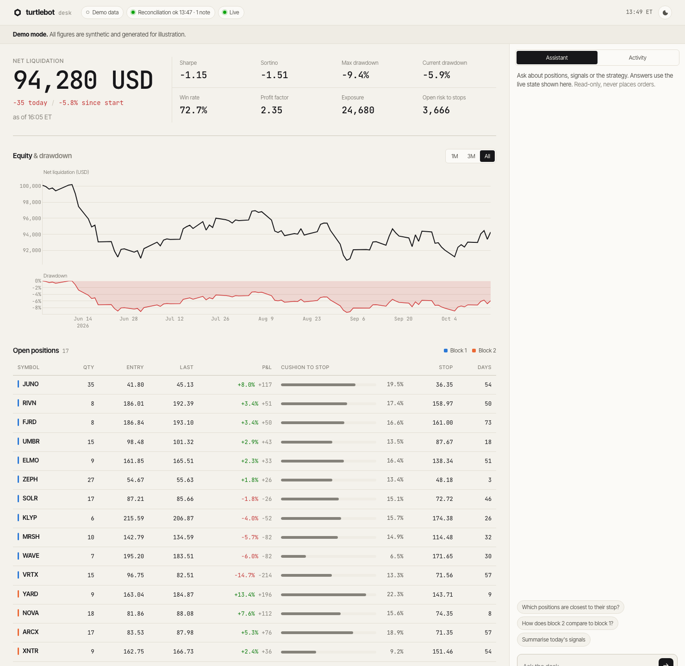
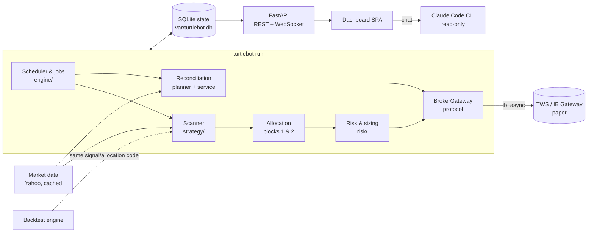

# turtlebot

**A Turtle/Donchian breakout trading bot for Interactive Brokers paper accounts, with a SQLite-backed state store, a safety-first reconciliation and a real-time dashboard.**

[](.github/workflows/ci.yml)


> [!WARNING]
> **Paper-trading and learning project, not investment advice.** The bot only connects to IBKR *paper* accounts (port 7497, account ids starting with `D`) and refuses everything else. Backtest and paper results say nothing about future returns. Use at your own risk.



<details><summary>Dark theme</summary>


</details>

*Screenshots show the built-in demo mode with synthetic data.*

---

## What it does

| | |
|---|---|
| **Strategy** | Long-only Donchian breakout: close above the 20-day high with volume > 1.5x its 20-day average. Initial stop at the 10-day low, trailed upwards every morning. |
| **Two blocks** | Two independent slot pools (20 each) fed by the same scan. Block 1 takes the strongest signals; block 2 only takes signals with breakout strength >= 10 % that block 1 does not hold. |
| **Execution** | Scan at 15:45 ET, entries as market-on-close (market-on-open after the MOC cutoff), each as a bracket with an attached GTC stop. |
| **Risk** | 1.5 % of net liquidation per position, margin cushion check (TWS what-if), daily loss kill switch (-2 %), max 10 new entries per block and day. |
| **State** | SQLite store as the bot's source of truth; every reconciliation with the broker is recorded with its discrepancies. |
| **Dashboard** | FastAPI REST + WebSocket backend, hand-built frontend: equity & drawdown, live positions with cushion to stop, P&L per block, risk metrics, activity feed and an integrated assistant. |

All parameters are configurable (see [`.env.example`](.env.example)); the defaults reproduce the production setup exactly.

## Architecture



```
src/turtlebot/
├── config.py            Pydantic settings (.env, TURTLE_* variables)
├── exceptions.py        Exception hierarchy (transient vs. fatal broker errors, ...)
├── logging_setup.py     JSON-lines logs + order audit log
├── domain/models.py     Broker-independent value objects
├── strategy/            signals (Donchian), scanner, block allocation
├── risk/                position sizing, kill switches, margin checks
├── broker/              BrokerGateway protocol, IBKR adapter, dry-run wrapper, backoff
├── data/                market data protocol + Yahoo implementation
├── persistence/         SQLite schema/migrations and StateStore
├── reconciliation/      pure planner + executor (see below)
├── engine/              TradingEngine, job runner, watchdog
├── backtest/            portfolio backtest reusing the live strategy code
├── analytics/           Sharpe, Sortino, drawdown, win rate, profit factor ...
├── dashboard/           FastAPI app, read model, chat, static frontend
├── migration.py         import of the legacy JSON state / CSV journal
└── cli.py               `turtlebot` command
```

Design principles:

* **Pure core, thin adapters.** Signals, allocation, risk checks, the reconciliation planner and the metrics are pure functions over domain objects. Everything that touches TWS, the network or the clock is injected. That makes the trading logic testable without a broker.
* **One code path.** The backtest uses the same signal, allocation and sizing functions as the live engine.
* **Fail safe, not silent.** Unclear broker data means *do nothing destructive and alert*, never *assume everything is closed*.

## State management & the 12.10.2026 incident

On 12.10.2026 the legacy bot reconnected to TWS and received an empty position list before TWS had finished syncing. Its reconciliation took that at face value: it "forgot" all 20 open positions **and cancelled their stop-loss orders**, leaving the positions unprotected.

A second, related problem followed: the stops re-placed by the repair script belonged to API client id 50, so from 13.10. on every attempt of the bot (client id 11) to trail them was rejected by TWS (error 103) while the legacy state recorded the intended prices.

The new design prevents both structurally:

1. **Local source of truth.** Positions, orders, stops and every event live in SQLite (`var/turtlebot.db`, WAL mode). Nothing is rewritten wholesale; each change is a transaction.
2. **Reconciliation is a plan, not a side effect.** `reconciliation/planner.py` compares the store with a broker snapshot and returns explicit *discrepancies* plus *actions*. Every run is persisted (`reconciliations`, `discrepancies` tables) and visible in the dashboard.
3. **Safety rules:**
   * snapshots without a confirmed end of the position stream are ignored (`ABORTED`);
   * 0 broker positions while positions are tracked, without matching executions -> `ABORTED`;
   * a large share of positions vanishing at once -> `DEGRADED`: nothing is closed or cancelled;
   * a single missing position is closed only after a SELL execution proves it, or after it is missing for N consecutive runs;
   * a stop is cancelled only once its position is confirmed closed; the executor additionally refuses to cancel a SELL order for any symbol the broker still reports as held.
4. **Stop ownership.** TWS only lets the API client id that placed an order change it. Stops placed by another client id (e.g. a repair script, or manually in TWS) are read via `reqAllOpenOrders()`, count as protection, are reported with symbol, order id and client id, and are never modified or cancelled. If TWS rejects a modification (e.g. error 103), the bot cancels the old stop and only places a replacement after TWS confirms the cancellation; otherwise it leaves the old stop in place and alerts. `turtlebot audit-orders` (read-only session) lists all working orders not owned by the bot.
5. **Unverified stops.** Stops imported from the legacy state are marked unconfirmed; the first reconciliation reports any difference to the working TWS stop as `stop_price_mismatch` with both values.
6. **Checked price data.** Before a stop is trailed, the Yahoo 10-day low is compared with TWS's own (adjusted) daily bars; if they differ by more than 2 % the TWS low is used, and without TWS bars the stop is not trailed in that run. Warnings (log, notification, dashboard) flag lows far below the surrounding closes and the pattern of a pending cash takeover (jump on heavy volume, then a pinned price), where the trailing stop stays far below the price for up to 10 sessions. The dashboard also warns when a stop is more than 25 % below the price. None of this changes the strategy.
7. **Regression tests** replay the incident end to end (`tests/reconciliation/test_incident_20261012.py`): empty list, partially synced list, glitch persisting for 10 cycles, lost local state. In each case no stop is cancelled and no position is forgotten.

## Setup

Requirements: Python 3.12+, TWS or IB Gateway with API access enabled on the paper port 7497 ("Read-Only API" off), optionally [Claude Code](https://claude.com/claude-code) for the dashboard assistant.

```bash
git clone <repo> && cd turtlebot
python3 -m venv .venv && source .venv/bin/activate
pip install -e ".[dev]"
cp .env.example .env          # adjust if needed; .env is git-ignored
pre-commit install
```

### Migrating from the legacy bot

```bash
turtlebot migrate-legacy --state live_turtle_state.json --journal live_turtle_journal.csv
turtlebot report               # check positions and the imported history
```

Run the migration right before switching over, while the legacy bot is stopped. The legacy state file is treated as authoritative for open positions; false EXIT rows from the 12.10. incident are recognised and ignored.

### Running

```bash
turtlebot run --dry-run --once   # connect read-only, reconcile, one scan, no orders
turtlebot run --dry-run --reconcile-only  # read-only reconciliation, no scan
turtlebot run --dry-run          # full schedule without orders (separate database)
turtlebot run                    # paper trading - requires TURTLE_TRADING_ENABLED=true
turtlebot dashboard              # http://127.0.0.1:8000
turtlebot dashboard --demo       # synthetic data, no account needed
turtlebot backtest --universe .cache/live/eligible_20261009.json --start 2016-01-01 --end 2026-10-01
```

`turtlebot run` refuses to place orders unless `TURTLE_TRADING_ENABLED=true` is set explicitly. The paused state is the default.

### Logs

* `var/log/turtlebot.jsonl`: everything, one JSON object per line (`jq 'select(.level=="WARNING")'`)
* `var/log/orders.jsonl`: audit trail of every order event (placed, modified, cancelled, filled)

## Development

```bash
pytest                 # 260+ tests, ~93 % coverage, never touches TWS (in-memory fake broker)
mypy                   # --strict
ruff check . && black --check .
```

CI (GitHub Actions) runs lint, type check and the test matrix on Python 3.12–3.14 for every push.

Test highlights: regression test that the signal is identical to the legacy implementation; reconciliation incident replay; partial fills (entry and stop), cancelled partial entries, lost stops, TWS rejecting a stop modification, disconnects with backoff and alerts, empty/stale/malformed market data, job retries, watchdog timeouts, backtest stop logic checked against the legacy research backtest.

## Legacy code

`legacy/` keeps the original monolithic bot and the research scripts for traceability; `dashboard/` is the old Streamlit dashboard. Neither is imported by `src/`.

## License

[MIT](LICENSE). It is the simplest permissive licence: anyone may read, reuse and learn from the code, the copyright notice stays, and there is no warranty. That suits a personal learning and portfolio project. A copyleft licence such as GPL would only matter if derived trading systems had to stay open, which is not a goal here.
