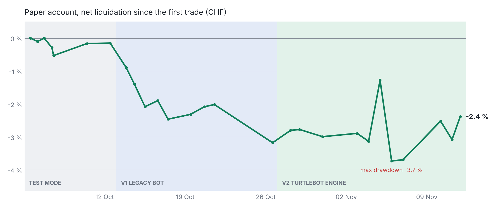

# Paper-trading results

**As of 11 Nov 2026, US close.** IBKR paper account, base currency CHF, about 1 million CHF of
simulated capital. These are real paper results from the full period since the first trade.
Nothing is cut out, including the weeks that went badly. Five and a half weeks is far too short to
judge a trend-following strategy, so treat this as a progress report, not a track record.

<picture>
  <source media="(prefers-color-scheme: dark)" srcset="img/paper-account-dark.png">
  
</picture>

## Headline

Strategy results under the production rules. The two test-mode days at the start (05–06 Oct) were
a functional test of order routing with different rules and are not counted here; they are shown
separately below.

| | Value | Note |
|---|---|---|
| **Trades under the production rules** | **+9,300 USD** (+0.8 %) | entries from 13 Oct, realised and unrealised, to 11 Nov |
| S&P 500 over the same window | −2.4 % | 13 Oct close → 11 Nov close |
| **Account since the v2 engine (27 Oct)** | **+0.9 %** | 967,287 → 976,137 CHF; S&P 500 over the same days −0.6 % |
| Average exposure | 37 % (max 62 %) | 1.5 % of equity per position, up to 40 positions |
| Beta to the S&P 500 | 0.40 | correlation 0.79, 26 trading days |

### Whole account, including the test-mode days

| | Value | Note |
|---|---|---|
| Net liquidation 05 Oct → 11 Nov | 999,928 → 976,137 CHF (−2.4 %) | as reported by TWS, after commissions; test-mode trades −35,600 USD |
| Max drawdown | −3.7 % (daily) / −4.0 % (intraday low, 06 Nov) | |
| Volatility, annualised | 10.6 % | S&P 500 over the same days: 19.7 % |
| Positions | 66 (26 closed, 40 open) | |

Raw data: [`data/paper_account.csv`](data/paper_account.csv). The chart is rendered by
[`scripts/plot_paper_account.py`](../scripts/plot_paper_account.py). Before 27 Oct the account
value only exists in the legacy bot's log (one value per start), so the early part of the curve
has gaps; from 27 Oct on, the engine records a snapshot on every loop.

## Where the loss came from

Almost the whole loss comes from the first two days, when the bot still ran in **test mode**:
a looser signal (10-day breakout, 1.3× volume, hourly intraday scans) whose only purpose was
to prove that order routing, fills and stops work end to end. Everything bought since then
under the production rules is in profit in total.

| Phase | Positions | Closed (winners) | Open (in profit) | Realised | Unrealised | Total |
|---|---|---|---|---|---|---|
| Test mode, entries 05–06 Oct | 20 | 17 (2) | 3 (3) | −39,200 USD | +3,600 USD | **−35,600 USD** |
| v1 legacy bot, production rules, 13–26 Oct | 17 | 8 (2) | 9 (7) | −11,400 USD | +11,200 USD | **−100 USD** |
| v2 turtlebot engine, from 27 Oct | 27 | 1 (0) | 26 (13) | −4,900 USD | +11,800 USD | **+6,800 USD** |
| **Total** | 64 | 26 (4) | 38 (23) | −55,500 USD | +26,600 USD | **−28,900 USD** |

*Per-trade figures in USD, reconstructed from entry and exit prices as of 09 Nov, before
commissions. The CHF account value above is the authoritative number; both give −2.3 % on 09 Nov.
By the 11 Nov close the production-rules trades stood at +9,300 USD and the test-mode trades at
−35,600 USD.*

**Why realised P&L alone is misleading here.** A breakout system cuts losers quickly and lets
winners run, so for weeks the closed trades are mostly the losers. Closed-trade statistics
(win rate 15 %, profit factor 0.03) say little while the winners are still open: REPL +40 %,
XNCR +32 %, APOG +17 %, ORKA +16 %, APP +15 % at the time of the review. That is why every number
on this page uses total equity, realised plus unrealised.

## Against the market

The weeks from early October to early November were a split market: a handful of mega-cap tech
names fell hard while the typical stock rose.

| Window | Bot | S&P 500 (cap-weighted) |
|---|---|---|
| **Production rules**, entries 13 Oct – 11 Nov | **+0.8 %** (+9,300 USD) | **−2.4 %** |
| **Account since the v2 engine**, 27 Oct – 11 Nov | **+0.9 %** | **−0.6 %** |

Other indices, 02 Oct – 11 Nov 2026:

| Index | Return |
|---|---|
| S&P 500, equal-weighted | +6.5 % |
| S&P 400, cap-weighted | +1.7 % |
| S&P 600, cap-weighted | +2.0 % |

*Index returns were rebuilt from the constituents' closing prices in the bot's cache, weighted by
market cap and counting dual share classes (GOOG/GOOGL, FOX/FOXA, NWS/NWSA) once. Over the last
23 days for which SPY itself is cached, the rebuilt S&P 500 returned −0.77 % against −0.87 % for
SPY (daily correlation 0.994), so expect an error of a few tenths of a percentage point.*

The bot gained while the S&P 500 fell, with less than half of the market's exposure (beta 0.4).
The production-rules figure is the trades' P&L in USD before commissions, relative to the account
of about 1.2 million USD. The test-mode trades are not part of it; the whole account including
them stood at −2.4 % against −1.3 % for the index. Over a few weeks none of these differences is
statistically meaningful.

## What the data does say

* **The stops do their job.** Holding the 26 closed positions until 09 Nov instead of stopping
  out would have cost −88,400 USD instead of −55,500 USD.
* **The signal had an edge.** The 586 production signals since 12 Oct were on average +2.3 %
  ahead five days later, against −0.6 % for the universe; 70 % were up after ten days. This is
  before stops and on a short history, so it is a hint, not a proof.
* **Losers are large because initial stops are wide.** The initial stop sits at the 10-day low,
  on average 27 % below the entry (range 11–59 %). A stopped-out trade lost 14.9 % on average.
* **Ranking by breakout strength attracts takeover targets.** Five positions jumped 29–72× on
  volume after an acquisition announcement and have barely moved since. They occupy 5 of 40 slots
  with almost no upside. The bot already flags the pattern (`possible_takeover`); excluding such
  signals from allocation is the next change on the list.
* **Execution is clean.** Average entry slippage +0.16 %, +0.21 % with market-on-close orders.

## Operations

| Date | Event | Consequence |
|---|---|---|
| 12 Oct | Legacy bot reconnects, receives an empty position list and cancels all 20 stops | Rewrite with a reconciliation that can never act on incomplete broker data, see the [README](../README.md#state-management--the-12102026-incident) |
| 14 / 16 Oct | Two orders reported as cancelled were partly filled | Picked up later by the reconciliation |
| 22–23 Oct | Legacy bot not running | No scans, no stop updates; broker-side stops stayed active |
| 27 Oct – 02 Nov | Ten migrated positions gone at the broker without a reported execution | Closed after 13 runs with unknown exit price; `turtlebot import-executions` now backfills it from the IBKR trade export |

The laptop running the bot is shut down every night after the US close. Positions stay protected
by their GTC stop orders at the broker; the engine reconciles and catches up on a missed stop
update on the next start.

## Data caveats

* Ten exits from the legacy period have no reported execution price and are estimated from the
  stop prices in force at the time. Importing the IBKR trade export with
  `turtlebot import-executions` will replace them with the executed prices.
* Commissions and interest are only contained in the account value, not in the trade table.
* The account is in CHF and the positions in USD; a stronger franc lowers the CHF value without
  any change in the positions.

## What happens next

The bot keeps running unchanged. A fair verdict on win rate, payoff ratio and the difference
between block 1 and block 2 needs two to three months of closed trades. Planned changes, each with
a backtest first: exclude takeover targets from allocation, and cap the number of positions per
country or theme.
